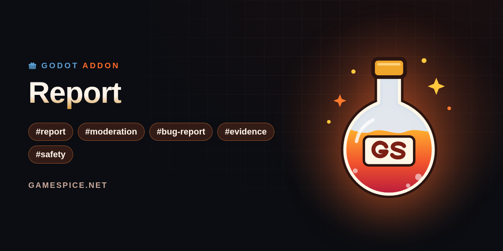

[](https://moddingcommunity.com/a/151-gs-report)

Godot 4.7+ addon for player reports and bug reports: a report form model, evidence capture (log ring, screenshot, replay clip reference), rate limits, and hand-off to GameSpice Moderation and the TMC backbone. Part of the GameSpice addon family.

A player who reports someone, or a bug, should have it land with enough context to act on and no way to flood the inbox. This addon checks the form, keeps the last log lines as evidence, holds references to a screenshot and a replay clip, rate-limits the reporter, and then hands the finished report to you. It does not send or judge anything itself.

Passed reports wait in `report.outbox` (`GSReportOutbox`) until the game delivers them: `peek(n)`, send, then `ack(n)`. `to_array()` and `load_array()` let GameSpice Save keep the box across sessions, so an offline report is not lost. A full box (`outbox_max`, 0 is unlimited) refuses the new report with a quota error instead of dropping one.

## Install

1. Copy `addons/gs_report/` and `addons/gs_core/` into your project.
2. Enable GameSpice Report in *Project > Project Settings > Plugins*.

## Quick start

```gdscript
var report := GSReport.new()
report.config = GSReportConfig.from_files().value   # layered cfg, env and flags
add_child(report)

# Keep evidence: have your log handler call this for every line.
report.log_line("player entered dust")

# Note where you saved a screenshot or a replay clip (references only).
report.evidence.attach_screenshot("user://shots/last.png")
report.evidence.attach_replay("replay:1042")

# Hand the finished report to Moderation or your own client.
report.submitted.connect(func(r): moderation_intake(r))
report.rejected.connect(func(reason, code): show_to_player(reason))

report.submit({"reporter": my_id, "kind": "player", "target": other_id,
        "category": "cheating", "text": "Snapped onto me through the wall."})
```

A report dictionary holds `id`, `reporter`, `kind`, `category`, `target`, `text` and an `evidence` block with `log`, `screenshot`, `replay` and `dropped`. `GSReportForm`, `GSReportEvidenceRing` and `GSReportLimiter` work on their own too.

## Settings

Every number is a field on `GSReportConfig`. A value of 0 means unlimited or off; the inspector ranges are slider limits, not enforced caps.

| Setting | Default | What it does |
| --- | --- | --- |
| `enabled` | true | Off, every submit is refused with a reason. |
| `endpoint` | empty | Where the game's client sends reports (https, or http on localhost). |
| `kinds` | player, bug | The report kinds the form accepts. |
| `max_text` | 2000 | Longest report text; 0 is unlimited. A longer one is refused, not cut. |
| `max_field` | 128 | Longest category or target; 0 is unlimited. |
| `cooldown_seconds` | 60 | Wait between reports from one reporter; 0 is none. |
| `max_per_hour` | 10 | Reports per reporter per hour; 0 is unlimited. |
| `duplicate_seconds` | 300 | Window in which the same report again is refused; 0 turns it off. |
| `max_reporters` | 0 | Reporters the limiter remembers; 0 is unlimited. |
| `evidence_lines` | 200 | Log lines in the evidence ring; 0 is unlimited. |
| `include_screenshot` | true | Carry the screenshot reference on a report. |
| `include_replay` | true | Carry the replay reference on a report. |

Layers, weakest first: the defaults, `cfg/addon/gs_report/*.yml`, the game's files, the operator's files, `GS_REPORT_*` environment variables, then `--report-*` flags.

## What it is not

- Not moderation: warnings, mutes, bans and appeals are GameSpice Moderation. A report is its input, not a verdict.
- Not a logger: shipping and storing log records is GameSpice Log. The evidence ring here is a short bounded window for one report.
- Not detection: spotting cheats on the server is GameSpice Anticheat and GameSpice Server Security. A detector's finding can become evidence on a report.
- Not an uploader: it holds references to a screenshot or a clip, never the bytes, and it sends nothing. Your game's client delivers the report.

## Test

```bash
godot --headless --path . --import
godot --headless --path . res://examples/report_selftest.tscn
```

The self-test is offline and exits non-zero on any failure.

## Status

Built and maintained with Claude Code. The test suites pass, but little of this has been in front of real players yet. Please report rough edges by opening an issue.

## Licence

MIT. See [LICENSE](LICENSE). Only the TMC back-end web infrastructure is not open source.
